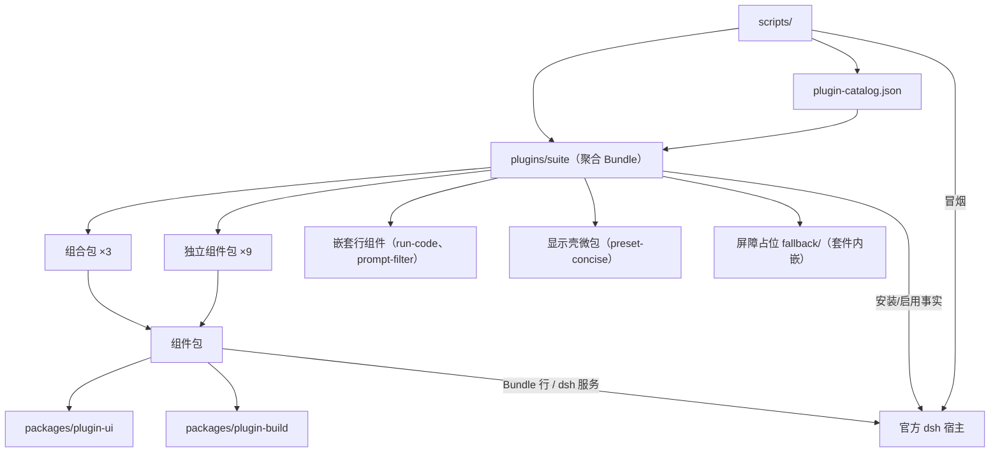

# 架构概览

> 由 architecture-map 技能生成于 2026-10-10；模块结构变化后需重新生成。

dsh-kit 是官方 DeepSeek Harness (dsh) 的第三方插件套件仓库：没有应用进程，没有自有数据目录，
唯一的产物是可在官方 dsh 里安装的 Profile Bundle（套件包 `plugins/suite` 与组成它的组件包）。

## 模块一览

| 模块 | 路径 | 职责 | 主要依赖 |
|---|---|---|---|
| 组件包 | `plugins/<组件>/` | 单个功能插件：宿主半 `src/`、浏览器半 `src/client/`、Bundle 行 `cordis.patch.yml`、`locale/` 文案、`tests/` | dsh 宿主服务（`connection`、`tools`、`agents`、`settings` 等）、`@dsh-kit/plugin-ui` |
| 组合包 | `plugins/{model-enhancements,conversation-enhancements,development-tools}/` | 只有 `cordis.patch.yml`：把若干组件聚成一个安装/停用单位 | 所属组件包（固定版本 dependencies） |
| 套件包 | `plugins/suite/` | 唯一对外分发包：生成的聚合 patch + 物化依赖闭包 + 内嵌屏障占位（`fallback/`，经套件 exports 子路径装载） | 全部组件包、显示壳微包、registry 闭包 |
| 嵌套行组件 | `plugins/{run-code,prompt-filter}/` | 无自身 profile 行：只被简洁预设的 `config.plugins` 按裸包名引用（run_code 双通道、预设提示词段落过滤） | dsh 宿主服务（`tools`、`systemPrompt`） |
| 显示壳微包 | `plugins/preset-concise/` | 无源码的空壳：给裸包名行提供中文 locale 元数据 | 无 |
| 构建工具 | `packages/plugin-build/` | `createPluginBuildConfig`：所有插件的 tsdown 配置工厂与产物约定 | tsdown、rolldown |
| 浏览器半共享 UI | `packages/plugin-ui/` | 对话框全屏、导航图标（nav glyph）等浏览器侧共享样式与几何 | dsh 客户端 primitives（external） |
| 开发与冒烟脚本 | `scripts/` | 套件生成、开发实例、隔离真机冒烟、依赖版本检查 | `scripts/lib/` 共享夹具 |
| 分发清单 | `plugin-catalog.json` | 组件 → 组合包/独立包的映射与顺序约定 | 被脚本与文档引用 |
| 契约文档 | `docs/` | 产品决策、上游源码核对结论、路线图与插件索引 | 无 |

## 依赖关系图

无循环依赖；组件包之间没有相互 import（跨插件协作一律通过 dsh 的服务与事件）。

## 关键约定

- **两层产物**：宿主半 `dist/index.js` + 浏览器半 `dist/client.js`，都挂在包根 `./dist/*`
  （dsh 会把 patch 里的相对入口锚定到该文件目录，发行包移动后仍可解析）。
- **装载路径只有一条**：官方「添加插件」→ `plugins/suite` → Bundle 选择写入
  `dsh.profile.bundles`；组件行的 `disabled` 表达式由 `scripts/build-suite.mjs` 生成，
  套件离开 bundles 时全部组件行一并禁用。
- **套件 patch 是生成物**：文件头两段固定契约（`llm-pi-ai` 启动屏障、模型屏障占位行），
  其余为各组件 patch 的顶层条目改写；不要在仓库里手改 `plugins/suite/cordis.patch.yml`。
- **依赖闭包物化**：本地目录安装是 pnpm `link:` 语义，套件自带 `node_modules/`；
  `@deepseek-ai/*` 由 dsh 运行时树提供，不复制第二份单例。
- **无自有状态**：插件配置写 dsh profile 的 settings 与 profile patch；仓库不写
  `~/.dsh-*` 之外的项目目录，也不注入环境变量。
- **开发隔离**：`pnpm dev` 用 `~/.dsh-dev` 与端口 3180，profile `dsh-kit-dev`；
  冒烟脚本从该 profile 复制隔离副本后再启动真实 dsh。
