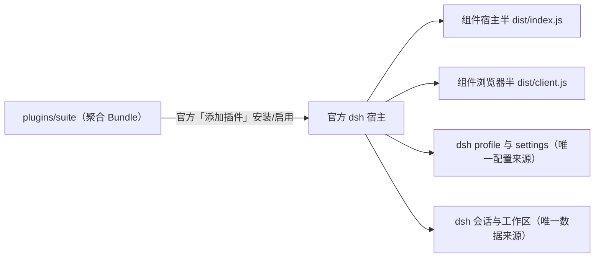

# 03 · 架构

## 1. 全景

官方 dsh（桌面版或 web 版）是唯一宿主：Agent、工具、会话、界面与服务都由它提供。
本项目是它的第三方插件套件——一个 Bundle 包 `plugins/suite`，安装后把 24 个组件挂进宿主。
项目里没有常驻进程，也没有自有数据目录。



## 2. 仓库组成

| 路径 | 职责 |
|---|---|
| `plugins/<组件>/` | 单个功能插件：宿主半、浏览器半、Bundle 行、locale 文案、测试 |
| `plugins/<组合包>/` | 组合分发：只含 `cordis.patch.yml`，把若干组件聚成一个安装/停用单位 |
| `plugins/suite/` | 唯一对外分发包：生成的聚合 patch（只有 insert 行，D16）+ 自包含物化依赖闭包（组件以 peerDependencies 声明，D20）+ 中文元数据；`pnpm suite:pack` 由此打出 GitHub Release tarball |
| `packages/plugin-build/` | `createPluginBuildConfig`：所有插件的 tsdown 配置工厂与产物约定 |
| `packages/plugin-ui/` | 浏览器半共享 UI（对话框全屏、导航图标、几何断言） |
| `plugin-catalog.json` | 组件 → 组合包/独立包的映射、顺序与停用粒度约定 |
| `scripts/` | 套件生成、开发实例、隔离冒烟、依赖版本检查 |
| `docs/` | 决策、上游契约、路线图与插件索引 |

## 3. 装载与停用

dsh 的三层事实（契约出处见 [插件机制](dsh/plugins.md)）：

| 事实 | 存在位置 | 改动方式 |
|---|---|---|
| 是否安装 | profile `dependencies` | 官方「添加插件」安装/卸载 |
| 是否启用 | profile `dsh.profile.bundles` 数组 | 插件页 Bundle 开关 |
| 组件是否停用 | profile patch 里该行的 `disabled` | 插件详情里的组件开关 |

套件 patch 由 `scripts/build-suite.mjs` 生成：

1. 文件头固定契约——套件层只有 insert 行，永不覆写官方行（D16）。
2. 各组件自己 `cordis.patch.yml` 的顶层条目被改写成裸包名行
   （`name: '@dsh-kit/dsh-plugin-x'`，loader 从套件 `node_modules/` 解析），并逐行补
   「套件成员 + 组件包可解析」双条件 `disabled: !!js …` 守卫（运行中首次启用时探测不到
   就整行禁用、延迟到重启装载，不产生 failed to import）。
3. 生成后把组件包与 registry 依赖闭包物化进 `plugins/suite/node_modules/`
   （`@deepseek-ai/*` 由宿主运行时树提供，不复制第二份）。

自包含契约（D20）：套件 package.json 零 dependencies，24 个组件声明为 peerDependencies
（精确版本）。pnpm 安装 tarball 时不解析任何 registry 依赖；dsh 启动时按「选中 bundle 的
deps+peers 闭包」从套件锚物理探测组件（进 runtime resolution 表），裸包名行与客户端半
照常发现。本地目录（link: 语义）、本地 tarball、GitHub Release 资产三者安装的是同一棵
自包含树；`pnpm suite:pack` 打 tarball，`release.yml` 在 push `v*` 标签时自动发布。

顺序约定：`proxy` 先于模型组件生效；其余按名字排序。组件包之间没有 import 依赖，
跨插件协作一律走 dsh 的服务与事件。

## 4. 插件包结构

```text
plugins/<组件>/
  package.json        # name、version、dsh.bundle.patch、dsh.client、exports['./client']
  cordis.patch.yml    # Bundle 行（insert 内的稳定 id + name: './dist/index.js'）
  src/index.ts        # 宿主半：inject 声明所需服务，注册工具/RPC/设置
  src/client/index.tsx# 浏览器半：槽位、设置分区、注入样式
  locale/{zh,en}.json # 插件页显示的标题与描述
  tests/              # Vitest（宿主半 + 浏览器半）
  tsdown.config.ts    # createPluginBuildConfig({ ... })
```

两层产物都必须存在：`dist/index.js`（宿主）与 `dist/client.js`（浏览器）。
构建缺失时 `pnpm plugins:build` 与 `pnpm suite:build` 都会响亮失败。

## 5. 技术选型

| 用途 | 实现 |
|---|---|
| 语言、工作区 | TypeScript、ESM、pnpm workspace（`packages/*`、`plugins/*`） |
| 构建、开发、测试 | tsdown（rolldown）、tsx、Vitest |
| 校验、依赖注入 | dsh 自带的 schemastery/cordis 机制；插件不引第二套运行时 |
| 直接依赖 | 固定版本；dsh 家族版本由根 `pnpm.overrides` 钉住 |
| 进程与原生能力 | 一律经 dsh 提供的服务（`tools`、`terminal`、`sandboxPolicy` 等），插件不引原生模块 |

## 6. 开发与验证链

| 命令 | 作用 |
|---|---|
| `pnpm plugins:build` | 构建全部插件的两层产物（`packages/plugin-ui` + `plugins/**`） |
| `pnpm suite:build` | 生成套件 patch 并物化依赖闭包到 `plugins/suite/node_modules/` |
| `pnpm suite:pack` | 构建 + 物化后打成自包含 tarball（`release/dsh-kit.tar.gz` 固定名 + `dsh-kit-<版本>.tar.gz` 版本名双资产，发布产物） |
| `pnpm dev` | 隔离开发实例：DSH_HOME=`~/.dsh-dev`、profile `dsh-kit-dev`、端口 3180，启动前自动检查运行时并安装套件 |
| `node scripts/<主题>-check.mjs` | 隔离 home + 真实 dsh 的冒烟断言，入口表见 [源码依据](02-dsh-facts.md) |
| `node scripts/verify-suite-client.mjs --token <token>` | 校验运行中宿主首页的 `__DSH_BOOT__` 图含全部 24 个浏览器行 |

套件所在 profile 没有 HMR：改动插件任何一半后都要重新构建并重启 dsh。
